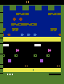
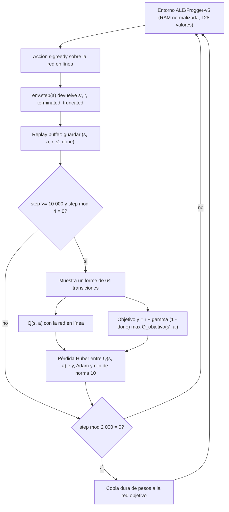
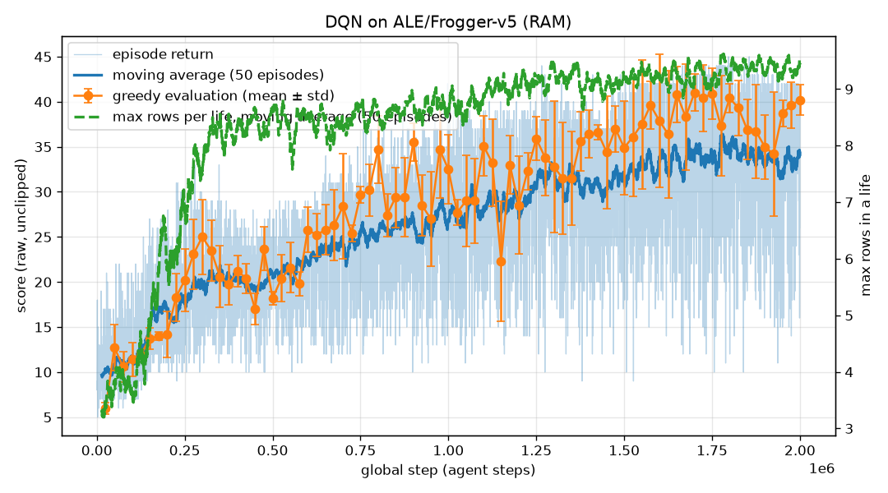
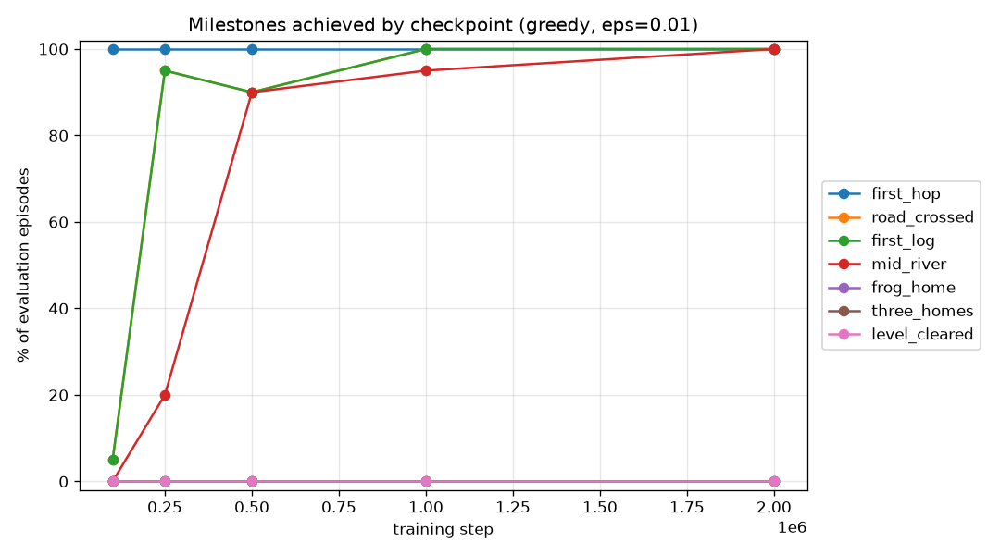
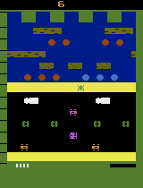
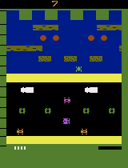
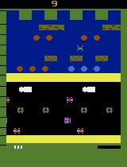

# frogger-dqn-lab

**Taller 2 (U3) — Grupo 2.** Agente DQN implementado desde cero con **PyTorch + Gymnasium**, sin
Stable-Baselines3, que aprende a jugar `ALE/Frogger-v5` a partir de la observación RAM de la consola.

Este repositorio es independiente del taller de PPO (`frogger-rl-lab`), que usa Stable-Baselines3 y se
entregó por separado.

<table>
<tr>
<td align="center"><b>Política aleatoria</b><br></td>
<td align="center"><b>DQN tras 2 000 000 de pasos</b><br></td>
</tr>
</table>

## Resumen

| Elemento | Valor |
|---|---|
| Entorno | `ALE/Frogger-v5`, observación RAM (128 bytes), acciones discretas (5) |
| Algoritmo | DQN: buffer de repetición, ε-greedy, red objetivo, pérdida Huber |
| Red | MLP 128 → 256 → 256 → 5, ReLU, 100 101 parámetros |
| Entrenamiento | 2 000 000 de pasos en CPU, 45 min (738.9 pasos/s) |
| Resultado principal | Puntaje greedy 39.3 ± 2.9 a 2M pasos, frente a 9.4 ± 2.3 de la política aleatoria |

## Entorno

### Observación

- **Espacio de observación:** `Box(0, 1, (128,), float32)`. El entorno entrega la RAM de la consola
  (128 bytes, `uint8` en `[0, 255]`), que el wrapper `RamFloatObservation` normaliza dividiendo entre 255
  (`dqn_frogger/env.py`).
- **Por qué RAM y no píxeles:** el DQN clásico usa frames de 84×84 apilados y una CNN, lo que requiere
  millones de pasos. Con el plazo disponible elegimos la RAM: el juego es el mismo y solo cambia la
  representación del estado. El costo es que la RAM no tiene estructura espacial explícita, así que la
  red debe descubrir qué posiciones codifican al sapo y a los autos. Véase
  [`docs/notas-de-desarrollo.md`](docs/notas-de-desarrollo.md), sección 2.

**¿Por qué no apilamos frames?** Con píxeles, una sola imagen no muestra velocidad ni dirección, por eso el DQN clásico apila cuatro cuadros. La RAM codifica el estado interno del juego (posiciones de sapo, autos y troncos), y en Frogger cada carril tiene velocidad y dirección fijas, así que en principio un solo vector basta para decidir. Esto es una razón de diseño, no una prueba: en la rama experimental, apilar 4 frames de píxeles con una CNN no rompió por sí solo el techo de la fila 10 (corrida con buffer 100k).

### Acciones

Espacio de acciones `Discrete(5)`:

| Índice | Acción |
|---|---|
| 0 | NOOP |
| 1 | UP |
| 2 | RIGHT |
| 3 | LEFT |
| 4 | DOWN |

Configuración por defecto de la versión `v5` de ALE: `frameskip = 4` y `repeat_action_probability = 0.25`
(sticky actions). El límite de truncamiento es `max_num_frames_per_episode = 108 000` cuadros, es decir,
27 000 pasos del agente con `frameskip = 4`. Todo verificado con `env.spec.kwargs` y el entorno instanciado.

### Recompensas y terminación

- **Recompensa:** +1 por cada salto hacia adelante que alcanza una fila nueva dentro de la vida actual.
  En las trayectorias de este agente no observamos otros valores; el bono de llegar a casa se describe en [Particularidades del ambiente](#particularidades-del-ambiente). La fila se confirmó en RAM: el byte 90 cuenta las filas de la
  vida actual y coincide con el conteo de recompensas en todos los pasos de cinco episodios
  (`docs/notas-de-desarrollo.md`, sección 4).
- **Recorte de recompensa:** el entrenamiento usa el signo de la recompensa (`reward_clip = True`). Como
  las recompensas observadas en este agente son 0 o 1, el recorte no cambia ningún valor. Los registros (`episodes.csv`) guardan
  el puntaje sin recortar.
- **Vidas:** 5 sapos por partida (4 de reserva en `info["lives"]`). Detalle en [Particularidades del ambiente](#particularidades-del-ambiente).
- **Terminación (`terminated`):** el episodio termina cuando el juego llega a *game over*, es decir, cuando
  las vidas llegan a 0. Verificado: en episodios aleatorios, `terminated = True` coincide con `lives = 0`.
- **Truncamiento (`truncated`):** el entorno corta el episodio al llegar al límite de 108 000 cuadros.
- **Tratamiento en Bellman:** solo `terminated` anula el valor del estado siguiente. Si un episodio se
  trunca, la red sigue estimando el valor futuro. El buffer guarda `done = terminated`
  (`dqn_frogger/trainer.py`).

### Particularidades del ambiente

- **Sticky actions:** con probabilidad 0.25 se repite la acción anterior. En el río, un salto de más es caer al agua.
- **Cinco sapos por partida:** `info["lives"]` empieza en 4 porque cuenta las vidas de reserva. Perder un sapo no termina el episodio (verificado: 5 sapos por partida en la evaluación del agente de 2M).
- **Recompensa:** +1 por fila nueva en la vida actual. El contador de filas se reinicia con cada sapo (byte 90 de la RAM), así que las mismas filas vuelven a pagar. No hay castigo por morir. Llegar a casa da +51 a +55 (bono que incluye el tiempo restante; verificado con una traza paso a paso en la rama experimental). Con el recorte por signo valdría +1.
- **Carretera y río piden reglas opuestas:** en la carretera hay que esquivar objetos; en el río, pararse sobre ellos.
- **Truncamiento no es fin del juego:** por eso el buffer guarda `done = terminated`.

## Flujo de entrenamiento

<p align="center"></p>

<details>
<summary>Código fuente del diagrama (Mermaid)</summary>



</details>

### Componentes

- **Replay buffer:** capacidad de 100 000 transiciones en un arreglo circular. Cuando está lleno,
  sobrescribe la más antigua. Cada lote se muestrea uniformemente con reemplazo.
- **ε-greedy:** con probabilidad ε la acción es aleatoria; si no, es la de mayor Q. ε decrece linealmente
  de 1.0 a 0.05 en 150 000 pasos y después se mantiene en 0.05.
- **Red objetivo:** una copia de la red en línea que se actualiza por copia dura cada 2 000 pasos. Estabiliza
  el objetivo de Bellman, porque evita que el objetivo cambie con cada paso de gradiente.
- **Actualización de Bellman:** la red en línea se ajusta hacia el objetivo

  $$
  y = r + \gamma \,(1 - \mathrm{done})\, \max_{a'} Q_{\bar\theta}(s', a')
  $$

  minimizando la pérdida de Huber $\ell_\delta\big(Q_\theta(s, a) - y\big)$ con $\delta = 1$
  (`smooth_l1_loss`). La red objetivo $Q_{\bar\theta}$ no recibe gradiente.
- **Optimización:** Adam con tasa de 1e-4 y recorte de la norma del gradiente en 10.0.

### Hiperparámetros

Valores tomados de `dqn_frogger/config.py` y `dqn_frogger/agent.py`. La corrida de 2M se lanzó con
`--total-steps 2000000`; el resto de valores es el de `config.py` (véase la nota de reproducción sobre `config.json`).

| Parámetro | Valor | Razón |
|---|---|---|
| Pasos totales | 2 000 000 (por defecto en `config.py`: 300 000) | Presupuesto de la corrida principal; 300 000 es la línea base. |
| Capacidad del buffer | 100 000 | Diversidad suficiente con poca memoria (vectores de 128 bytes). En la rama experimental (píxeles) el tamaño fue decisivo: con 100k el agente nunca llegó a casa y con 200k llegó en el 90 % de los episodios de evaluación. |
| Tamaño de lote | 64 | Gradiente menos ruidoso que con 32 y barato en CPU. |
| Factor de descuento γ | 0.99 | Horizonte efectivo de ~100 pasos. Un sapo dura ~30–45 pasos del agente (el primero ~126, porque incluye ~110 pasos de espera al inicio de la partida), así que cubre una vida completa. |
| Tasa de aprendizaje (Adam) | 1e-4 | Baja, porque el objetivo se mueve; pasos grandes desestabilizan. |
| Inicio del aprendizaje (`learning_starts`) | 10 000 pasos | Evita entrenar sobre un buffer casi vacío y correlacionado. |
| Frecuencia de entrenamiento (`train_freq`) | cada 4 pasos | Una actualización cada 4 pasos (valor del DQN original). |
| Sincronización de la red objetivo | cada 2 000 pasos | Equivale a 500 actualizaciones con el objetivo fijo. |
| ε inicial / final | 1.0 / 0.05 | Exploración total al inicio y residual después. |
| Pasos de decaimiento de ε | 150 000 (lineal) | Calibrado para la corrida de 300k. En la de 2M, el decaimiento cubrió el 7.5 % y el 92.5 % restante se entrenó con ε = 0.05 (punto para la discusión). |
| Recorte de recompensa | signo (`reward_clip = True`) | Estándar en Atari. No tuvo efecto práctico porque el agente RAM nunca llegó a casa (todas sus recompensas fueron +1); si llegara, convertiría +51/+55 en +1. |
| Clip de la norma del gradiente | 10.0 | Limita actualizaciones bruscas. |
| Pérdida | Huber (`smooth_l1_loss`, δ = 1) | Robusta a errores grandes. |
| Semilla de entrenamiento | 42 | Una sola semilla por corrida; no mide la variación entre semillas. |
| Evaluación durante el entrenamiento | cada 25 000 pasos, 10 episodios, ε = 0.01 | ε = 0.01 evita bucles deterministas. |
| Checkpoints | 100 000, 250 000, 500 000, 1 000 000, 2 000 000 (y el paso final) | Permiten evaluar el progreso por etapas en el leaderboard. |

## Arquitectura de la red

`QNetwork` (`dqn_frogger/network.py`): una MLP con activaciones ReLU y salida lineal.

```
Entrada (128) → Linear(128, 256) → ReLU → Linear(256, 256) → ReLU → Linear(256, 5)
```

Número de parámetros: **100 101** (33 024 + 65 792 + 1 285), verificado con `sum(p.numel())`. La red
objetivo tiene la misma arquitectura y el mismo número de parámetros.

| Capa | Entrada → salida | Parámetros (pesos + sesgos) |
|---|---|---|
| `Linear` + ReLU | 128 → 256 | 128 × 256 + 256 = 33 024 |
| `Linear` + ReLU | 256 → 256 | 256 × 256 + 256 = 65 792 |
| `Linear` (salida) | 256 → 5 | 256 × 5 + 5 = 1 285 |

### Por qué este diseño

- **MLP y no CNN.** Una convolución aprovecha que los píxeles vecinos están relacionados. En la RAM, dos
  bytes contiguos no tienen por qué estarlo: uno puede ser una posición y el siguiente un contador. Sin
  estructura espacial, la capa adecuada es la densa, que conecta cada byte con todas las neuronas.
- **Entrada de 128.** Un valor por byte de la RAM, ya normalizado a `[0, 1]`. No hay kernels ni strides
  porque no hay convoluciones.
- **Dos capas ocultas de 256.** Es un tamaño habitual para entradas vectoriales pequeñas y no lo
  comparamos con otros. La primera capa puede combinar bytes (por ejemplo, la posición del sapo con la de
  un auto) y la segunda, combinar esas combinaciones.
- **ReLU.** Activación estándar en DQN: es barata de calcular y no satura para valores positivos.
- **Salida lineal de 5 valores.** Una sola pasada da el valor Q de las cinco acciones, así que elegir la
  acción greedy cuesta una evaluación de la red. No lleva activación final porque Q es un número real sin
  cota fija.
- **Red pequeña a propósito.** Con 100 101 parámetros, cada actualización tarda 2.1 ms en CPU y el
  entrenamiento completo cabe en 45 minutos (véase [CPU frente a GPU](#cpu-frente-a-gpu-medido)).

## Resultados

### Alcance de la evaluación

Las evaluaciones periódicas y por checkpoints utilizan ε = 0.01 según el protocolo documentado, por lo que conservan un 1 % de selección aleatoria de acciones y no son estrictamente greedy.
Los valores se presentan como media ± desviación estándar entre episodios. Los hitos expresan la proporción de episodios que los alcanza al menos una vez, no la tasa de éxito de cada intento.

### Hardware y tiempo

- **CPU:** `AMD64 Family 23 Model 113`, PyTorch 2.14.1+cpu, Python 3.11.9.
- **Tiempo:** 2 706.68 s (≈ 45 min) para 2 000 000 de pasos, a **738.9 pasos/s** (`results/run_2m/timing.json`).
- Comparación medida con GPU: véase [CPU frente a GPU](#cpu-frente-a-gpu-medido).
- La estimación inicial fue de 1 a 3 horas. La medición del entrenamiento de 300 000 pasos fue de 6 min 21 s.

### CPU frente a GPU (medido)

Medimos la misma configuración y la misma semilla en CPU y en una **GTX 1660 SUPER**, dentro de un
mismo entorno con PyTorch 2.11.0+cu128 (`benchmarks/cpu_vs_gpu.py`, resultados en
`results/benchmark_cpu_gpu.json`):

| Medición | CPU | GPU (GTX 1660 SUPER) |
|---|---|---|
| Emulador solo, acciones aleatorias, sin red | 2 191.4 pasos/s | — |
| Una actualización de la red (lote de 64) | **2.135 ms** | 3.371 ms |
| Entrenamiento de 100 000 pasos | **133.0 s (751.8 pasos/s)** | 172.3 s (580.6 pasos/s) |
| Evaluación greedy a 100 000 pasos (10 episodios) | 8.3 ± 2.3 | 11.9 ± 1.8 |

- **La GPU fue un 23 % más lenta.** La red tiene 100 101 parámetros y se entrena con lotes de 64: en la
  GPU pesa más el costo fijo de copiar cada lote y lanzar los kernels que el cálculo en sí.
- **El emulador marca el ritmo.** Sin red, el emulador da 2 191 pasos/s; con aprendizaje la CPU baja a
  752 pasos/s. Ese tiempo extra se reparte entre elegir acciones y actualizar la red, y ninguna de
  las dos partes se acelera en la GPU con una red tan pequeña.
- **El resultado del aprendizaje no depende del dispositivo.** Las diferencias de puntaje a 100 000
  pasos (8.3 frente a 11.9) son ruido de una sola corrida corta: el cómputo en coma flotante no es
  idéntico entre CPU y GPU, así que las trayectorias divergen. Con una sola semilla por dispositivo
  no hay evidencia de que uno aprenda mejor.
- La GPU sí sería decisiva en la variante con píxeles y una CNN (`docs/notas-de-desarrollo.md`, sección 3).

### Curva de aprendizaje



La curva muestra el retorno de cada episodio (raw, sin recorte), su promedio móvil de 50 episodios, la
evaluación greedy cada 25 000 pasos (media ± desviación estándar) y el máximo de filas por vida.

### Interpretación de la curva de aprendizaje

La curva reúne los retornos de 7 408 episodios de entrenamiento y 80 evaluaciones realizadas cada 25 000 pasos. Los retornos individuales muestran fluctuaciones, mientras el promedio móvil de 50 episodios permite observar la tendencia general. Este promedio suaviza la variación, pero no significa que todos los episodios tengan un desempeño similar.

Las evaluaciones muestran una mejora general: el retorno medio pasa de 6.0 puntos a los 25 000 pasos a 40.2 al finalizar los 2 millones. Sin embargo, el progreso no es monótono. El mayor retorno medio evaluado fue de 41.0 a los 1.7 millones de pasos; posteriormente disminuyó hasta 34.2 a los 1.925 millones y se recuperó al final. Por tanto, la curva respalda aprendizaje, pero no demuestra una convergencia definitiva ni una mejora continua.

En las últimas 20 evaluaciones, correspondientes al tramo posterior a 1.5 millones de pasos, las medias se encuentran entre 34.2 y 41.0 puntos. Esto indica que el agente mantiene un nivel de recompensa superior al observado al inicio, aunque todavía presenta variación entre evaluaciones.

También es necesario distinguir entrenamiento y evaluación. Según la configuración documentada, el entrenamiento mantiene ε = 0.05 después del periodo de decaimiento, mientras las evaluaciones periódicas utilizan ε = 0.01. En los últimos 50 episodios de entrenamiento, el retorno promedio fue de 34.32 puntos. Su diferencia con la evaluación final no implica una contradicción: ambos registros corresponden a condiciones de actuación distintas y no son directamente equivalentes.

Las barras de error representan la desviación estándar de los retornos de los 10 episodios de cada evaluación. Describen la dispersión entre partidas, no un intervalo de confianza ni la variabilidad entre entrenamientos independientes.

### Línea base a 300 000 pasos

Evaluación greedy de 20 episodios (`results/baseline_300k/evaluation.json`):

| Política | Puntaje medio ± desv. estándar |
|---|---|
| Aleatoria | 9.45 ± 2.11 |
| DQN (300 000 pasos) | 25.20 ± 4.35 |

### Evaluación final frente a aleatoria

| Fuente | Episodios | Aleatoria | DQN a 2M pasos |
|---|---|---|---|
| Evaluación durante el entrenamiento (`results/run_2m/eval.csv`, última fila) | 10 | — | 40.2 ± 1.7 |
| Leaderboard por checkpoint (`results/run_2m/leaderboard.md`) | 20 | 9.4 ± 2.3 | 39.3 ± 2.9 |

Ambas fuentes usan semillas distintas, por eso los valores difieren ligeramente.

### Tabla de medallas

Cada medalla se marca si al menos el 50 % de los 20 episodios alcanzó el hito dentro de una vida
(`results/run_2m/leaderboard.md`):

| Checkpoint | Episodios | Puntaje | Filas máx. (media / máx.) | Casas (media / máx.) | 🐸 first_hop | 🥉 road_crossed | 🪵 first_log | 🥈 mid_river | 🥇 frog_home* | 🏆 three_homes* | 👑 level_cleared* |
|---|---|---|---|---|---|---|---|---|---|---|---|
| random | 20 | 9.4 ± 2.3 | 3.3 / 7 | 0.00 / 0 | 🐸 100% | 5% | 5% | 0% | 0% | 0% | 0% |
| 100,000 | 20 | 12.2 ± 1.9 | 3.5 / 7 | 0.00 / 0 | 🐸 100% | 5% | 5% | 0% | 0% | 0% | 0% |
| 250,000 | 20 | 20.6 ± 3.2 | 7.7 / 10 | 0.00 / 0 | 🐸 100% | 🥉 95% | 🪵 95% | 20% | 0% | 0% | 0% |
| 500,000 | 20 | 18.0 ± 2.0 | 8.5 / 9 | 0.00 / 0 | 🐸 100% | 🥉 90% | 🪵 90% | 🥈 90% | 0% | 0% | 0% |
| 1,000,000 | 20 | 32.0 ± 4.3 | 9.7 / 10 | 0.00 / 0 | 🐸 100% | 🥉 100% | 🪵 100% | 🥈 95% | 0% | 0% | 0% |
| 2,000,000 | 20 | 39.3 ± 2.9 | 9.9 / 10 | 0.00 / 0 | 🐸 100% | 🥉 100% | 🪵 100% | 🥈 100% | 0% | 0% | 0% |

Umbrales: 🐸 `first_hop` = fila 1; 🥉 `road_crossed` = fila 6; 🪵 `first_log` = fila 7; 🥈 `mid_river` = fila 9.
La fila de casa es la 12.

\* **Medallas proxy no verificadas.** La detección de casa no está validada contra trazas de RAM. Por eso
`frog_home`, `three_homes` y `level_cleared` son estimaciones y no logros confirmados del juego. En la rama experimental `exp/home-challenge`, la recompensa de casa (+51 a +55; vidas sin cambio y contador de filas reiniciado) se verificó con una traza paso a paso; en `main` las medallas de casa siguen siendo proxies.



### Interpretación de los hitos de avance

La gráfica de hitos complementa el retorno acumulado al mostrar qué proporción de los 20 episodios evaluados alcanza determinadas etapas del juego. Estos porcentajes se calculan por episodio: alcanzar un hito al menos una vez no significa que el agente lo consiga en todas sus vidas o intentos.

Entre 100 000 y 250 000 pasos, la proporción de episodios que cruza la carretera aumenta del 5 % al 95 %. En ese mismo intervalo, alcanzar el primer tronco también pasa del 5 % al 95 %. Esto respalda una mejora importante en el avance hacia el río.

Entre 250 000 y 500 000 pasos, el hito de mitad del río aumenta del 20 % al 90 %, aunque el retorno medio disminuye de 20.6 a 18.0 puntos. Las métricas muestran aspectos distintos del comportamiento: obtener menos recompensa acumulada puede coincidir con alcanzar una etapa más avanzada. Los registros disponibles no permiten identificar una causa única de esta diferencia.

A los 2 millones de pasos, los 20 episodios evaluados alcanzan los hitos de carretera, primer tronco y mitad del río. Sin embargo, el máximo registrado continúa en 10 filas y no se reportan casas. Entre 1 y 2 millones de pasos, el retorno medio aumenta de 32.0 a 39.3, pero el máximo avance registrado no aumenta. Por eso distinguimos mejora de recompensa y ampliación del alcance del agente.

El hito first_hop aporta poca capacidad de comparación, porque también lo alcanza la política aleatoria en el 100 % de los episodios. Los indicadores frog_home, three_homes y level_cleared son proxies sin validación independiente y no deben interpretarse como logros confirmados del juego.


### Progresión en GIF

Primer episodio de evaluación de cada checkpoint (`results/run_2m/gifs/`):

<table>
<tr>
<td align="center"><b>Aleatoria</b><br></td>
<td align="center"><b>100 000</b><br></td>
<td align="center"><b>250 000</b><br></td>
</tr>
<tr>
<td align="center"><b>500 000</b><br></td>
<td align="center"><b>1 000 000</b><br></td>
<td align="center"><b>2 000 000</b><br></td>
</tr>
</table>

### Capturas del primer hito

| Hito | 2 000 000 pasos |
|---|---|
| Cruzar la carretera (`road_crossed`) |  |
| Primer tronco (`first_log`) |  |
| Mitad del río (`mid_river`) |  |

### Observaciones

- **El aprendizaje ocurre por etapas.** Entre 100 000 y 250 000 pasos, cruzar la carretera pasa de 5 % a 95 %.
  Entre 250 000 y 500 000 pasos, llegar a la mitad del río pasa de 20 % a 90 %.
- **El puntaje oculta la habilidad.** A 500 000 pasos el puntaje medio bajó de 20.6 a 18.0, pero la medalla
  `mid_river` subió de 20 % a 90 %. El puntaje solo no muestra que el agente cruza el río con más frecuencia.
- **Techo en la fila 10.** El máximo de filas en una vida fue 10 a 1 000 000 y 2 000 000 de pasos. Ningún
  episodio llegó a la fila 12, así que no hay evidencia de casas (`homes_max = 0` en todos los checkpoints).
- **La medalla `first_hop` no discrimina.** La política aleatoria la alcanza en el 100 % de los episodios.

## Reflexión sobre los resultados

> Borrador dos de la reflexión de grupo


Los resultados muestran que el agente aprendió a obtener mayor recompensa y a alcanzar etapas más avanzadas que la política aleatoria.
En la evaluación por checkpoints, el retorno medio después de 2 millones de pasos fue de 39.3 puntos, frente a 9.4 de la política aleatoria.
Esta mejora respalda el aprendizaje bajo el protocolo utilizado, aunque no significa que el agente haya resuelto Frogger.

El aprendizaje se manifestó por etapas. Primero aumentó la frecuencia con la que el agente cruzaba la carretera y después mejoró su avance hacia la mitad del río.
Sin embargo, el retorno y los hitos no siempre evolucionaron en la misma dirección: a los 500 000 pasos, el puntaje medio disminuyó mientras aumentaba la proporción de episodios que alcanzaba la mitad del río.
Esta observación nos llevó a evaluar el progreso con ambas métricas, porque una caída del retorno no demuestra por sí sola una pérdida de aprendizaje.

También distinguimos obtener más recompensa de superar nuevas etapas. Entre 1 y 2 millones de pasos, el retorno medio aumentó, pero el máximo registrado permaneció en 10 filas y no se reportaron casas.
Por tanto, la evidencia muestra una mejora en el desempeño parcial, con una dificultad pendiente para completar el recorrido.
Una posible explicación es que el agente acumule menos experiencia en las zonas finales, pero sería necesario analizar las visitas y pérdidas de vida por zona para comprobarlo.

**Por qué el puntaje ronda 40.** El agente avanza unas 8 filas por sapo en sus 5 sapos (filas por sapo observadas: 7 a 10, a veces 3 o 4; por ejemplo, [9, 10, 8, 8, 7] suma 42).

**Causa probable (hipótesis no verificada para el agente RAM).** La recompensa es +1 por fila nueva, no hay castigo por morir y solo el fin de la partida es terminal. Al morir, el sapo vuelve al inicio, donde las mismas filas vuelven a pagar. Con esa formulación, avanzar rápido rinde más que sobrevivir: el agente aprendió a avanzar rápido, no a sobrevivir.

**Nunca vio una casa.** En los 7 408 episodios de entrenamiento no hubo ninguna casa (fila máxima 11). La exploración ε-greedy no produce por azar la secuencia completa de movimientos que lleva a la fila 12, así que la red nunca experimentó la recompensa de casa.

**Prueba propuesta.** Un experimento natural es tratar la pérdida de vida como terminal, lo que cambia la señal que recibe la red. Limitación: esta lectura proviene de una sola semilla y no está verificada para el agente RAM.

Las evaluaciones periódicas presentan fluctuaciones incluso al final del entrenamiento.
Aunque el desempeño se mantiene por encima del observado al inicio, no podemos afirmar una convergencia definitiva.
Además, las desviaciones estándar describen diferencias entre episodios de evaluación; una sola corrida larga no permite establecer qué tan consistente sería el aprendizaje con otras semillas de entrenamiento.

Los hitos también tienen límites de interpretación. first_hop no distingue al agente entrenado de la política aleatoria, porque ambos lo alcanzan en todos los episodios evaluados. Los indicadores de casas son proxies cuya detección no fue validada contra trazas de RAM, por lo que no deben presentarse como logros confirmados.

Concluimos que el DQN mostró aprendizaje parcial y que combinar recompensa con hitos permitió comprender mejor su comportamiento.
Para fortalecer la evidencia, proponemos repetir entrenamientos con otras semillas, conservar la configuración y los resultados individuales de evaluación, y analizar las zonas donde se limita el avance antes de decidir qué cambios realizar en el agente.

## Reflexión: qué fue lo más difícil

<!-- BORRADOR: reescribir con la voz del grupo antes de entregar -->

> ✍️ Borrador para revisión del grupo.

Lo más difícil fue decidir qué observación usar con el plazo que teníamos. Los píxeles y una CNN eran la
versión clásica, pero requerían millones de cuadros que no cabían en el tiempo. Elegimos la RAM de 128 bytes
con una MLP. Ese cambio redujo el problema, aunque obligó a la red a descubrir por sí misma qué bytes
describen al sapo y a los autos.

La estimación de tiempo también fue un error. Pensábamos que el entrenamiento tomaría entre una y tres horas,
y el entrenamiento de 300 000 pasos en CPU terminó en 6 minutos. Aprendimos a medir antes de optimizar la
infraestructura.

Calibrar los hitos fue otra dificultad. Medimos las filas en cuadros renderizados y confirmamos el byte 90
de la RAM en cada paso de cinco episodios. La detección de casa nunca quedó verificada: el agente no pasó de
la fila 10, y la búsqueda en haz no encontró una trayectoria que llegara a la fila 12. Por eso las medallas de
casa son proxies, y así lo indicamos en las tablas.

La revisión independiente también nos enseñó algo. Su primera ejecución terminó con código de salida 0, pero
no leyó ningún archivo. Desde entonces verificamos el contenido de las salidas y no solo el código de salida.

Por último, el resultado de 500 000 pasos cambió nuestra lectura del progreso. El puntaje bajó, pero el
agente cruzaba el río con más frecuencia. Sin las medallas no habríamos visto esa mejora.

## Extensión: rompiendo el techo de la fila 10

El agente de este README no pasa de la fila 10 y nunca llega a casa. En la rama [`exp/home-challenge`](https://github.com/AlejoMoncada/frogger-dqn-lab/tree/exp/home-challenge) probamos una variante con píxeles, CNN (arquitectura de Nature DQN), Double DQN y n-step = 3.

- **Diseño mixto CPU/GPU:** 8 entornos en CPU (`AtariVectorEnv`) y la CNN en GPU. En un piloto de 100 000 pasos fue 4.9 veces más rápido que todo en CPU (607 frente a 123 pasos/s).
- **Ablación a 5 000 000 de pasos**, 20 episodios de evaluación con ε = 0.01 por checkpoint:

| Corrida | Buffer | Recompensa | Pérdida de vida | Semilla | 🥇 casa | Casas por partida (media / máx.) | 🏆 3 casas | Puntaje |
|---|---|---|---|---|---|---|---|---|
| 2 | 100k | signo | normal | 42 | 0 % | 0.00 / 0 | 0 % | 38.1 |
| 3 | 200k | escalada ×0.1 | normal | 42 | 60 % | 0.60 / 1 | 0 % | 78.2 |
| 3b | 200k | escalada ×0.1 | normal | 43 | 0 % | 0.00 / 0 | 0 % | 36.4 |
| 4 | 200k | signo | normal | 42 | 90 % | 0.90 / 1 | 0 % | 101.2 |
| 5 | 200k | signo | **terminal** | 42 | 90 % | 1.35 / 3 | **5 %** | **122.2** |

Lectura:

- **El buffer de 200k hizo posible llegar a casa, pero no lo garantiza.** Con 100k ninguna corrida llegó. Con 200k llegaron tres de cuatro corridas, pero la réplica 3b, con la misma configuración que la 3 y otra semilla, se quedó en la fila 10. Los resultados dependen de la semilla: con una corrida por configuración solo hay indicios.
- **Escalar la recompensa no mostró ventaja**: 60 % y 0 % frente a 90 % sin escalar.
- **Tratar la pérdida de vida como terminal (corrida 5) apoya la hipótesis de la reflexión.** Solo el aprendizaje cambia: el juego sigue con sus 5 sapos. En el tramo de 4M a 5M, las partidas de entrenamiento duraron un 65 % más que en la corrida 4 (696 frente a 422 pasos), y 535 de 1 434 partidas tuvieron 2 casas o más, con un máximo de 3. En ese mismo tramo, la corrida 4 tuvo 0 partidas con más de una casa en 2 363: perdía 4 de sus 5 sapos en el río antes de llegar. Es una sola semilla.
- **Duda abierta:** la corrida 3 se interrumpió por falta de memoria y se retomó a los 2.5M con el buffer vacío. Su salto llegó después de retomarla, y la réplica 3b, que corrió de corrido, no saltó. No sabemos si el reinicio influyó.

Estas corridas usan píxeles y CNN, no el agente RAM que se evalúa en este entregable. Son evidencia relacionada, no prueba directa. No hay código nuevo en `main`.

## Reproducción

Requisitos: [`uv`](https://docs.astral.sh/uv/). Las dependencias están fijadas en `uv.lock`.

```bash
uv sync --frozen                                          # instalar dependencias exactas
uv run pytest -q                                          # pruebas unitarias y de integración
uv run python train.py --smoke --output-dir runs/smoke    # entrenamiento de prueba (segundos)
uv run python train.py --total-steps 2000000 --output-dir results/run_2m   # corrida de 2M pasos
uv run python milestones.py --run-dir results/run_2m --episodes 20         # leaderboard y GIFs
uv run python milestones.py --run-dir results/run_2m --plot-only           # solo redibujar milestones.png
uv run python plot.py --input-dir results/run_2m          # curva de aprendizaje
uv run python evaluate.py --checkpoint results/run_2m/dqn_frogger.pt --episodes 20   # evaluación greedy
```

- `train.py` se niega a reutilizar un directorio que ya contiene una corrida. Para reemplazarla, usa
  `--overwrite`; solo borra los artefactos que el entrenador genera.
- Los checkpoints `*.pt` no se versionan (`.gitignore`). Se generan al entrenar y quedan en
  `results/<corrida>/checkpoints/` y en `dqn_frogger.pt`.
- `results/run_2m/` no incluye `config.json`, así que la configuración exacta de esa corrida se toma del
  comando anterior y de los valores por defecto de `config.py`.

## Estructura del proyecto

```
frogger-dqn-lab/
├── dqn_frogger/            # paquete del agente, sin dependencias de Stable-Baselines3
│   ├── agent.py            # red en línea y objetivo, ε-greedy y actualización de Bellman
│   ├── network.py          # MLP Q-network
│   ├── replay_buffer.py    # buffer circular con muestreo uniforme
│   ├── schedule.py         # decaimiento lineal de ε
│   ├── config.py           # hiperparámetros
│   ├── trainer.py          # bucle de entrenamiento, registros y checkpoints
│   ├── env.py              # fábrica del entorno con RAM normalizada
│   ├── milestones.py       # rastreador de filas, casas y medallas
│   ├── leaderboard.py      # estadísticas y tablas de medallas
│   └── evaluation.py       # episodios de evaluación
├── train.py                # entrada de entrenamiento
├── evaluate.py             # evaluación de un checkpoint
├── milestones.py           # leaderboard por checkpoint (GIFs y capturas)
├── plot.py                 # curva de aprendizaje
├── tests/                  # pruebas con pytest
├── results/
│   ├── run_2m/             # corrida de 2M pasos: leaderboard, curvas, GIFs y capturas
│   ├── baseline_300k/      # línea base de 300 000 pasos
│   └── calibration/        # calibración de filas con cuadros renderizados
├── docs/
│   ├── notas-de-desarrollo.md   # decisiones, medición, calibración y revisión independiente
│   └── codex-review.md          # informe de la revisión independiente
└── odd/tasks/dqn-frogger.md     # seguimiento de tareas
```

## Documentación

- [Notas de desarrollo](docs/notas-de-desarrollo.md): decisiones (RAM frente a píxeles, CPU frente a GPU),
  calibración de hitos y revisión independiente.
- [Informe de la revisión independiente](docs/codex-review.md): hallazgos y resoluciones.
